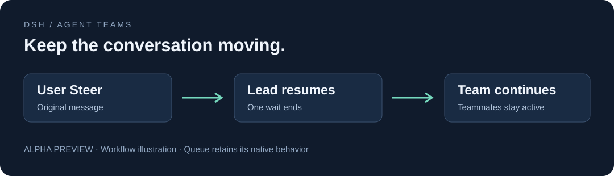

# Team Flow

**Steer the Lead while it waits. Let teammates keep working.**

[中文](README.md) · [npm · 0.2.0](https://www.npmjs.com/package/dsh-team-flow-continuous/v/0.2.0) · [Marketplace](https://awesome-dsh-plugin.com/p/jidekaixin2dian/dsh-team-flow/) · [Downloads](https://github.com/jidekaixin2dian/dsh-team-flow/releases) · [Changelog](https://github.com/jidekaixin2dian/dsh-team-flow/blob/main/CHANGELOG.md)

Team Flow is an Agent Teams steering plugin for DeepSeek Harness (DSH). A same-session user can **Steer** the Lead while it is waiting in `wait_agent`, ending that one wait so the native AgentLoop can consume the original message. Teammates continue working and Queue retains its semantics.

## Add a requirement while the team works

When the Lead is waiting for parallel tasks, send a Steer to add a requirement or redirect the task. The Lead can receive your message while teammates continue their work. Queue and normal sends keep their original behavior.



| Input | Behavior |
|---|---|
| Same Lead's user Steer | Ends this wait, allowing native message delivery to continue |
| Queue, generic send, inject | Keep their own semantics; do not count as Steer |
| Other Session or teammate input | Does not directly end this Lead's wait |
| Stop, guards, Team changes, timeout | Keep their native outcomes |

## Install and update

Requires **DSH >=0.2.0-rc.2 and Node >=24**, with official **Agent Teams** enabled first. CI covers DSH 0.2.1-alpha.1 / alpha.2 / rc.2 / rc.3 / rc.4 / 0.2.2-rc.1. See the [verification matrix](https://github.com/jidekaixin2dian/dsh-team-flow/blob/main/docs/verification.md).

Search for **dsh-team-flow**, source **jidekaixin2dian/dsh-team-flow**, in the marketplace. npm and GitHub installs include prebuilt files and need no install-script approval. The catalog prefers npm once mapped; source installs also support version checks. The default npm channel serves stable releases.

1. Wait for all Agents to become idle, back up your profile and preferably use a test profile.
2. Enable official Agent Teams, then install:

```powershell
dsh plugin --profile <test-profile> add dsh-team-flow-continuous --registry=https://registry.npmjs.org
```

3. Keep this bundle **after** Agent Teams. Restart if requested, open a new conversation and use Steer.

Run the same command to update. Existing `.tgz` installations can run it in the same profile to switch to the npm source for future marketplace update checks. Enter's behavior depends on DSH's send settings.

<details>
<summary>Ordering, disabling and removal</summary>

Bundle ordering metadata does not enable Agent Teams. This plugin disables the stock `tool-agent-team` entry and loads the host's own tool module, avoiding duplicate owners. Preserve custom `freshProvider` / `forkProvider` values in this plugin's configuration.

Use the marketplace's **package switch** or uninstall to remove the whole patch layer. Disabling only the loader entry can leave stock tools disabled.

```powershell
dsh plugin --profile <test-profile> remove dsh-team-flow-continuous
```

Operate while Agents are idle. Disabling an active wait returns `TEAM_FLOW_RC2_DISABLED`; uncaught PTC code may stop subsequent statements.

</details>

The marketplace checks versions and installs after your click; it does not silently upgrade in the background. Restart DSH when requested.

## Compatibility boundaries

- On DSH 0.2.2-rc.1, if a user Steer is already queued, Team Flow defers a foreground `workflow` called directly by the Lead. The Lead can reconsider the call after reading the message in its next step.
- Steer can end a `wait_agent` call early. During a foreground `workflow` that already started, a `workflow` inside `run_code`, or another long-running tool, the Lead picks up Steer at the next step boundary. If the host exposes `run_in_background`, pass `run_in_background: true` to `workflow` for long tasks so the Lead can continue processing Steer messages.
- Reversible runtime decorators reuse the host's own Team tools without patching host source or installation files.
- The plugin does not cancel Agents, consume Inbox messages or resend input. Its successful wake result is `{timedOut:false, reason:'user-steer'}`, not a fabricated timeout.
- Decorated methods are not dedicated extension hooks. Other decorators, cached methods or ABI changes can conflict. Detectable unsupported contracts retain native waiting with a warning; module incompatibility may prevent loading.
- User Steer means a user message delivered through `Agent.steer()`, not authentication that a third-party caller is human.
- Future host compatibility is not guaranteed and this is not an upstream-merged fix. Isolated Mock checks do not establish real-model behavior or production latency.

## Downloads

| GitHub archives | npm | Combined |
|---:|---:|---:|
| [794](https://api.github.com/repos/jidekaixin2dian/dsh-team-flow/releases?per_page=100) | [379](https://api.npmjs.org/downloads/point/2026-10-28:2026-11-04/dsh-team-flow-continuous) | **1,173 requests** |

Snapshot: 2026-11-06; npm data through 2026-11-04. GitHub counts installation archives; npm excludes `0.0.0-stage`. Includes repeat installs and automation, not unique users.

[Development](https://github.com/jidekaixin2dian/dsh-team-flow/blob/main/docs/development.md) · [Verification](https://github.com/jidekaixin2dian/dsh-team-flow/blob/main/docs/verification.md) · [Security](SECURITY.md) · [Issues](https://github.com/jidekaixin2dian/dsh-team-flow/issues)

Include DSH / Node / OS versions, Native or PTC, Steer / Queue settings and a minimal reproduction in reports. Redact credentials, authentication URLs and private conversations.

MIT · Independent community plugin, not affiliated with DeepSeek.
